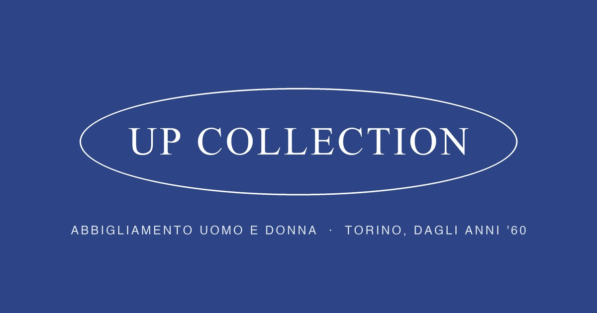

# Up Collection · [upcollectiontorino.com](https://upcollectiontorino.com)

**IT** — Il sito di **Up Collection**, negozio di abbigliamento donna e uomo in Corso Racconigi 159D a Torino (Borgo San Paolo). Catalogo online con i marchi del negozio, schede prodotto, orari e contatti. Progettato e realizzato da Erica Torta.

**EN** — The website of **Up Collection**, a women's and men's clothing store in Turin, Italy (Borgo San Paolo). Online catalogue of the store's brands, product pages, opening hours and contacts. Designed and built by Erica Torta.

## What's inside · Cosa c'è dentro

- Static site, no framework: hand-written HTML, CSS and JavaScript
- Bilingual IT/EN
- Catalogue generated from a JSON file (`assets/data/prodotti.json`): categories, brand pages, product pages with photo galleries
- Store info (hours, phone, WhatsApp, address) from one JSON file (`assets/data/negozio.json`)
- Local SEO: one landing page per brand and per department, `sitemap.xml`, structured data, Open Graph image, `llms.txt` for AI search
- Self-hosted fonts (Cormorant Garamond, Inter)
- Hosted on Cloudflare Pages with a custom domain; products are managed through a private admin panel (not included here)

## Note

This is a showcase copy: product photos and brand logos belong to their brands and are not included, so open the live site to see the full catalogue.

© 2026 Up Collection & Erica Torta. All rights reserved. The code is public to show the work, not to be reused.
Il codice è pubblico per mostrare il lavoro, non per essere riutilizzato.
